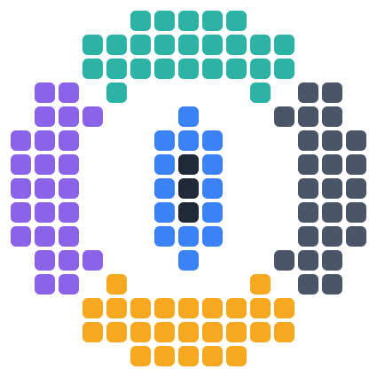

<p align="center">
	<a href="https://github.com/ToolAssisted-run/chimera/actions/workflows/ci.yml"></a>
	<a href="https://github.com/ToolAssisted-run/chimera/releases"></a>
	<a href="https://discord.gg/VsKDT9XB6u"></a>
</p>

<p align="center">
	<picture>
		<source media="(prefers-color-scheme: dark)" srcset="docs/Chimera.icon/Assets/icon-dark.svg">
		
	</picture>
	&nbsp;&nbsp;
	<picture>
		<source media="(prefers-color-scheme: dark)" srcset="docs/logotype-dark.svg">
		
	</picture>
</p>

<p align="center">Chimera is a modular frontend for creating tool-assisted speedruns (TAS).</p>

<p align="center">
	<a href="https://github.com/ToolAssisted-run/chimera"></a>
	<br>
	<a href="https://github.com/ToolAssisted-run/chimera"></a>
</p>

## Goals

- **Modularity.** The frontend contains no emulation core and no system-specific knowledge. Cores are external, self-contained packages (`.chimeraCore`), each maintained in its own repository under its own license, loaded explicitly like a ROM. Chimera includes none and downloads none.

- **Performance.** All functional machinery (the sandbox host, movies, savestates, file formats, the running machine itself) lives in `libchimera`, a native C++ engine the GUI calls into.

- **Stronger reproducibility guarantees.** Every core runs inside the [miniBox](https://github.com/ToolAssisted-run/chimera-common-minibox) sandbox, so the same project and input files play the same movie on any machine.

## Cores

Chimera does not include cores and does not download them. To use a core, download its `.chimeraCore` package from the core's own project (linked below) or build it yourself, and put it in the `cores` folder beside Chimera.

### Official cores

Made, published and supported by this project. Report a problem with one in [Chimera's issues](https://github.com/ToolAssisted-run/chimera/issues).

#### Emulation

| Core | Systems |
| --- | --- |
| [quickerNES](https://github.com/ToolAssisted-run/chimera-core-quickernes) | Nintendo Entertainment System / Famicom |
| [QuickerNesHawk](https://github.com/ToolAssisted-run/chimera-core-neshawk) | Nintendo Entertainment System / Famicom, Famicom Disk System |
| [Mesen](https://github.com/ToolAssisted-run/chimera-core-mesen) | Nintendo Entertainment System / Famicom, Famicom Disk System (with the EPSM sound expansion), Super Nintendo, Super Game Boy, Game Boy / Game Boy Color, Game Boy Advance, PC Engine / TurboGrafx-16, SuperGrafx, PC Engine CD, Master System, Game Gear, SG-1000, ColecoVision, WonderSwan / WonderSwan Color, Pocket Challenge V2 |
| [ares](https://github.com/ToolAssisted-run/chimera-core-ares) | Nintendo Entertainment System / Famicom, Super Nintendo, Satellaview, Sufami Turbo, Nintendo 64, Nintendo 64DD, Game Boy / Game Boy Color, Game Boy Advance, Mega Drive / Genesis, Mega Drive 32X, Sega CD / Mega CD, Sega CD 32X, Master System, Game Gear, SG-1000, PlayStation, Atari 2600, Atari 5200, ColecoVision, MSX / MSX2, PC Engine / TurboGrafx-16 / SuperGrafx, PC Engine CD / TurboDuo, Neo Geo AES, Neo Geo Pocket / Color, WonderSwan / WonderSwan Color |
| [Snes9x](https://github.com/ToolAssisted-run/chimera-core-snes9x) | Super Nintendo |
| [bsnes v115](https://github.com/ToolAssisted-run/chimera-core-bsnes115) | Super Nintendo, Super Game Boy |
| [Dolphin](https://github.com/ToolAssisted-run/chimera-core-dolphin) | GameCube, Wii |
| [Cemu](https://github.com/ToolAssisted-run/chimera-core-cemu) | Wii U |
| [Azahar](https://github.com/ToolAssisted-run/chimera-core-azahar) | Nintendo 3DS / New Nintendo 3DS |
| [melonDS](https://github.com/ToolAssisted-run/chimera-core-melonds) | Nintendo DS, Nintendo DSi |
| [Gambatte](https://github.com/ToolAssisted-run/chimera-core-gambatte) | Game Boy / Game Boy Color, Super Game Boy, Game Boy Link (two to four Game Boys joined by cable) |
| [Genesis Plus GX](https://github.com/ToolAssisted-run/chimera-core-gpgx) | Mega Drive / Genesis, Sega CD / Mega CD, Master System, Game Gear, SG-1000, Sega Pico |
| [Flycast](https://github.com/ToolAssisted-run/chimera-core-flycast) | Dreamcast, Sega NAOMI / NAOMI 2 (arcade), Sammy Atomiswave (arcade) |
| [Supermodel](https://github.com/ToolAssisted-run/chimera-core-supermodel) | Sega Model 3 (arcade) |
| [Mednafen](https://github.com/ToolAssisted-run/chimera-core-mednafen) | Sega Saturn, Sega ST-V (arcade), Virtual Boy, PC-FX, Atari Lynx |
| [FBNeo](https://github.com/ToolAssisted-run/chimera-core-fbneo) | Capcom CPS-1 / CPS-2 / CPS-3 (arcade), Neo Geo MVS (arcade), Neo Geo CD, Sega System 16 (arcade) |
| [MAME](https://github.com/ToolAssisted-run/chimera-core-mame) | Arcade (the arcade machines of MAME) |
| [MAME Home Systems](https://github.com/ToolAssisted-run/chimera-core-mamehome) | Atari 7800, Intellivision, Vectrex, Odyssey 2 / Videopac, Channel F, Amstrad CPC / CPC+ / GX4000, TI-83, BBC Micro |
| [DuckStation](https://github.com/ToolAssisted-run/chimera-core-duckstation) | PlayStation, Namco System 11 (arcade), Konami GQ (arcade) |
| [PCSX2](https://github.com/ToolAssisted-run/chimera-core-pcsx2) | PlayStation 2 |
| [PPSSPP](https://github.com/ToolAssisted-run/chimera-core-ppsspp) | PlayStation Portable |
| [Vita3K](https://github.com/ToolAssisted-run/chimera-core-vita3k) | PlayStation Vita |
| [RPCS3](https://github.com/ToolAssisted-run/chimera-core-rpcs3) | PlayStation 3 |
| [xemu](https://github.com/ToolAssisted-run/chimera-core-xemu) | Xbox |
| [Xenia](https://github.com/ToolAssisted-run/chimera-core-xenia) | Xbox 360 |
| [Opera](https://github.com/ToolAssisted-run/chimera-core-opera) | 3DO Interactive Multiplayer |
| [Zeebx](https://github.com/ToolAssisted-run/chimera-core-zeebx) | Zeebo |
| [Stella](https://github.com/ToolAssisted-run/chimera-core-stella) | Atari 2600 |
| [Virtual Jaguar](https://github.com/ToolAssisted-run/chimera-core-virtualjaguar) | Atari Jaguar, Atari Jaguar CD |
| [Cadmium](https://github.com/ToolAssisted-run/chimera-core-cadmium) | CHIP-8, SUPER-CHIP, XO-CHIP and their relatives |
| [TIC-80](https://github.com/ToolAssisted-run/chimera-core-tic80) | TIC-80 (fantasy computer) |
| [Uzem](https://github.com/ToolAssisted-run/chimera-core-uzem) | Uzebox |
| [AppleWin](https://github.com/ToolAssisted-run/chimera-core-applewin) | Apple II / II Plus / IIe (and the Pravets, TK3000 and Base64A clones) |
| [PUAE](https://github.com/ToolAssisted-run/chimera-core-puae) | Commodore Amiga, Amiga CD32, Commodore CDTV |
| [VICE](https://github.com/ToolAssisted-run/chimera-core-vice) | Commodore 64 |
| [Fuse](https://github.com/ToolAssisted-run/chimera-core-fuse) | ZX Spectrum 16K / 48K / 128K / +2 / +3, Timex, Pentagon, Scorpion |
| [ZEsarUX](https://github.com/ToolAssisted-run/chimera-core-zesarux) | ZX Spectrum Next |
| [MAME X68000](https://github.com/ToolAssisted-run/chimera-core-x68k) | Sharp X68000 |
| [DOSBox-X](https://github.com/ToolAssisted-run/chimera-core-dosbox-x) | MS-DOS, Windows 3.1 / 95 / 98 |
| [PCem](https://github.com/ToolAssisted-run/chimera-core-pcem) | MS-DOS, Windows 3.1 / 95 / 98, Windows XP, Linux (x86) |
| [86Box](https://github.com/ToolAssisted-run/chimera-core-86box) | IBM PC compatibles: IBM PC, XT and AT, a 486 and a Pentium board (MS-DOS) |
| [Ruffle](https://github.com/ToolAssisted-run/chimera-core-ruffle) | Flash |
| [EKA2L1](https://github.com/ToolAssisted-run/chimera-core-eka2l1) | Symbian / Nokia N-Gage |
| [touchHLE](https://github.com/ToolAssisted-run/chimera-core-touchhle) | iPhone OS 2.x-4.0 (iPhone, iPod touch and iPad apps) |
| [FreeJ2ME-Plus](https://github.com/ToolAssisted-run/chimera-core-freej2me) | J2ME (Java games of 2000s phones) |
| [Godot 4.7](https://github.com/ToolAssisted-run/chimera-core-godot47) | Godot 4.7 (games made with the Godot Engine) |
| [Godot 4.6](https://github.com/ToolAssisted-run/chimera-core-godot46) | Godot 4.6 |
| [Godot 4.5](https://github.com/ToolAssisted-run/chimera-core-godot45) | Godot 4.5 |
| [Godot 4.4](https://github.com/ToolAssisted-run/chimera-core-godot44) | Godot 4.0 to 4.4 |
| [OpenBOR](https://github.com/ToolAssisted-run/chimera-core-openbor) | OpenBOR (2D beat 'em up games) |
| [Ikemen GO](https://github.com/ToolAssisted-run/chimera-core-ikemen) | Ikemen GO (fighting games made with it, and M.U.G.E.N characters and stages) |
| [ScummVM](https://github.com/ToolAssisted-run/chimera-core-scummvm) | ScummVM (adventure games of LucasArts, Sierra and others, run from their own files) |

#### Games

One game each, run from the game's own files ([docs/game-cores.md](docs/game-cores.md)).

| Core | Games |
| --- | --- |
| [SDLPoP](https://github.com/ToolAssisted-run/chimera-core-sdlpop) | Prince of Persia (DOS) |
| [SDLPoP2](https://github.com/ToolAssisted-run/chimera-core-sdlpop2) | Prince of Persia 2: The Shadow and the Flame (DOS) |
| [OpenSamurai](https://github.com/ToolAssisted-run/chimera-core-opensamurai) | Sword of the Samurai (DOS) |
| [SyndicatFX](https://github.com/ToolAssisted-run/chimera-core-syndicatfx) | Syndicate (DOS) |
| [rawgl](https://github.com/ToolAssisted-run/chimera-core-rawgl) | Another World |
| [RSDKv3](https://github.com/ToolAssisted-run/chimera-core-rsdkv3) | Sonic CD (the 2011 remake) |
| [RSDKv4](https://github.com/ToolAssisted-run/chimera-core-rsdkv4) | Sonic the Hedgehog and Sonic the Hedgehog 2 (the 2013 remasters) |
| [RSDKv5](https://github.com/ToolAssisted-run/chimera-core-rsdkv5) | Sonic Mania |
| [RSDKv5U](https://github.com/ToolAssisted-run/chimera-core-rsdkv5u) | Sonic Origins (Sonic 1, Sonic 2, Sonic CD) |
| [DSDA-Doom](https://github.com/ToolAssisted-run/chimera-core-dsda) | Doom, Doom II, Final Doom, Heretic, Hexen, Chex Quest, Freedoom |
| [Open4DBoxing](https://github.com/ToolAssisted-run/chimera-core-open4dboxing) | 4D Sports Boxing (DOS) |

### Third-party cores

Made and published by other people from their own repositories, and listed here for information only. This project does not maintain or support them: report a problem with one in its own repository.

#### Emulation

| Core | Author | Systems |
| --- | --- | --- |
| [UnrealSpeccyP](https://github.com/CloakTheLurker/chimera-core-unrealspeccyp) | [CloakTheLurker](https://github.com/CloakTheLurker) | ZX Spectrum 128K (Pentagon), ZX Spectrum 48K |
| [Eden](https://github.com/mayonnaisegoodfellas/chimera-core-eden) | [mayonnaisegoodfellas](https://github.com/mayonnaisegoodfellas) | Nintendo Switch |
| [Gens-Rerecording](https://github.com/DmytroM1998/chimera-core-gens) | [DmytroM1998](https://github.com/DmytroM1998) | Mega Drive / Genesis |
| [NP2kai](https://github.com/ShinobiWannabe/chimera-core-np2kai) | [ShinobiWannabe](https://github.com/ShinobiWannabe) | NEC PC-9801 / PC-9821 (IA-32 CPU), NEC PC-9801 (286 CPU) |

#### Games

| Core | Author | Games |
| --- | --- | --- |
| [SRB2](https://github.com/P-AS/chimera-core-srb2) | [P-AS](https://github.com/P-AS) | Sonic Robo Blast 2 |

## Getting a build

Chimera is published as [**nightly builds**](https://github.com/ToolAssisted-run/chimera/releases) for Windows, Linux and macOS, each for x86_64 and aarch64.

A nightly is made each day `main` changed: it is the newest commit of `main` that passed its tests. It is dated and never changed or deleted, so a movie or a bug report can name the build it used.

A build carries no cores, and Chimera never uses the network. To set it up:

1. Download a build and unpack it.

   On Windows or Linux, take x86_64 unless you know your device is ARM.

   On a Mac, take aarch64 for Apple silicon (M1 and later) and x86_64 for an Intel Mac. macOS asks before opening it the first time, because it is not signed.

2. Download the `.chimeraCore` package of each core you want, from that core's releases page (the [Cores](#cores) tables link them).

   Packages are named `<core>-<version>-x86_64.chimeraCore` or `<core>-<version>-aarch64.chimeraCore`. Take the one that matches your build, and only one.

   Most cores have no aarch64 package yet; [docs/platforms.md](docs/platforms.md) says what runs where.

3. Put the packages in the `cores` folder beside the program (on a Mac, `~/Library/Application Support/Chimera/cores`), and start Chimera.

Cores publish nightlies the same way, and never delete them. So a movie can name the exact package that recorded it and still be replayed years later.

Every build carries `BUILD.txt`, naming the commit it was built from, and `LICENSES.md`, with its terms.

**A core adds its own terms.** Some (Genesis Plus GX, Opera, Snes9x) forbid commercial use. Chimera shows a core's licence once it is in the folder.

Core packages from before each core had its own repository are kept in the [`cores`](https://github.com/ToolAssisted-run/chimera/releases/tag/cores) release, named by SHA1. Nothing is added to it any more.

## Working with an AI agent

An AI agent (Claude Code, or any program that speaks MCP) can look at your open project and, if you allow it, edit it.

Start the server from **Tools > MCP Server...**, which also shows the command that sets the agent up. It is off until you start it, and nothing leaves your machine.

An agent can also work with no window, on a machine of its own. See [docs/mcp-server.md](docs/mcp-server.md).

## Building

Chimera is built with meson and Qt 6.12. Clone with `--recursive`. The repository holds no prebuilt programs and no cores.

Linux builds for Linux and cross-builds for Windows. macOS is built on a Mac ([docs/macos.md](docs/macos.md)). [docs/platforms.md](docs/platforms.md) says how each of the six builds is made and tested.

```
tools/ci-chimera.sh      # Qt 6.12 for Linux into ~/qt (aqt), then the Linux build
```

or by hand, with Qt 6.12 for Linux at `$QT`:

```
PATH="$QT/libexec:$QT/bin:$PATH" PKG_CONFIG_PATH="$QT/lib/pkgconfig" \
  meson setup build/meson-linux --prefix "$(pwd)/build" --libdir dll -Dqt_ui=enabled
meson compile -C build/meson-linux && meson install -C build/meson-linux
```

Linux needs meson, ninja, cmake, gcc and Qt 6.12 (Core, Gui, Qml, Quick, QuickControls2).

The Windows builds also need mingw-w64 (x86_64) or llvm-mingw (aarch64, `tools/fetch-llvm-mingw.sh`).

Releases build Qt themselves, without its network module (`tools/build-qt-linux.sh`, `tools/build-qt-windows.sh`). `tools/build-bundle.sh` makes the Linux and Windows bundles, and `tools/build-app-macos.sh` the Mac app.

Get at least one core before running:

```
tools/fetch-cores.sh                                # every published core -> build/Cores
<core checkout>/waterbox/build-package.sh -r $PWD   # or build one yourself
```

Run `build/meson-linux/source/ui/chimera` (with `CHIMERA_CORES_DIR=build/Cores`), then **File > New Chimera Project...** and pick a core. `--headless` runs it with no window, for a script or a test.

The end-to-end test runs with `tests/synth/run-witness.sh`.

The design log is [docs/design-principles.md](docs/design-principles.md). Building a new core is [docs/porting-a-core.md](docs/porting-a-core.md).

## Reporting a problem

Open an issue on this repository, whichever core it concerns. The issue form asks for what a fix needs.

In general, we do not fix nor report issues that are also present in the upstream cores.

What helps most:

- **Help > Report an Issue** opens the form and fills in its first lines: build, core, system, processor, memory, files and changed settings. It can also save the files worth attaching as one zip.

- **The build strings.** Help > Copy Version Info copies the frontend's and the core's versions. A frontend and a core from different days may not read each other's states, so match them before reporting a save or load problem.

- **The project file.** A `.chimeraProject` is small and names every file by hash. Attach it instead of describing it.

- **The crash files** (Windows). When Chimera or a core dies, it writes a note and a minidump (`<date> pid<N>.txt` and `.dmp`) into the `Crashes` folder of the data directory. Config > Data Directory... opens it (`%LOCALAPPDATA%\Chimera` by default).

  The sandbox also writes `minibox-diag.log` next to the program (on a Mac, in the data folder). Attach all three.

- **The core's log.** Help > Export Core Log... saves everything the core says to a file. It restarts the core so the log starts at boot. Use it again to stop, and attach the file.

## Contributing

Pull requests are welcome, from people and from people working with AI assistants.

A contribution should build, pass the end-to-end test, and stay within the project's scope.

You must have the right to submit the code under the MIT license. Anything derived from other works must respect their licenses and carry the attribution they require.

## Credits and license

**Chimera began as a fork of [BizHawk](https://github.com/TASEmulators/BizHawk).** It is under the MIT License, keeping the BizHawk team's copyright on the parts that come from BizHawk.

[LICENSE](LICENSE) has the terms. [NOTICE](NOTICE) says whose work it is and what the terms do not cover: the native libraries built from `extern/`, and why core packages carry their own licenses.

The people behind Chimera itself are in [CREDITS.md](CREDITS.md).
